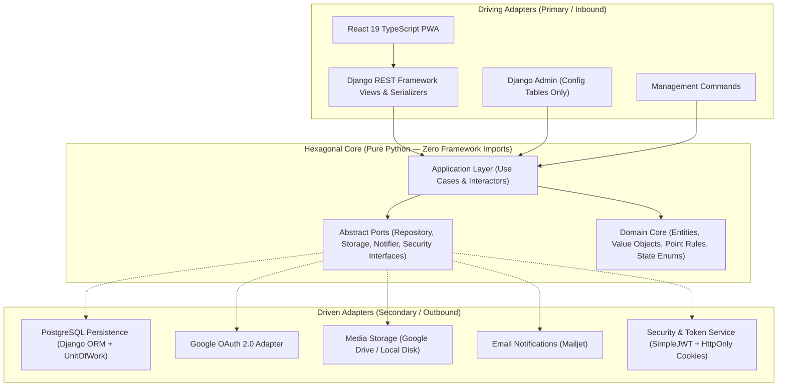

# 🌿 PlasticKothay

[](https://plastickothay-dev-1.onrender.com/)
[](https://github.com/mdrayhan03/plastickothay_dev/actions/workflows/backend-ci.yml)


PlasticKothay is a full-stack, crowdsourced environmental intelligence platform for reporting, mapping, and tracking plastic waste hot-spots in real time. It pairs an offline-first **React 19 PWA** with a production-grade **Django REST backend** architected strictly on **Hexagonal (Ports and Adapters)** principles.

**🌐 Live Application:** [plastickothay-dev-1.onrender.com](https://plastickothay-dev-1.onrender.com/)

---

## 🏛️ Architecture Overview

The backend is built around a pure, framework-free domain core. Business logic is completely isolated from web frameworks, ORMs, and third-party APIs. External systems plug into the core via abstract ports and swappable adapters.



### 🔒 Architectural Boundary Enforcement in CI
Architecture guidelines often erode over time. In PlasticKothay, **architectural boundaries are enforced programmatically in CI via `importlinter`**:
- `core/` is **strictly forbidden** from importing `django`, `rest_framework`, `psycopg`, `mongoengine`, `google`, or `celery`.
- A green test suite will fail in GitHub Actions if any framework dependency leaks into the domain core.
- Composition is explicitly wired through a single **Composition Root** (`backend/config/container.py`) using lightweight factory functions.

---

## ✨ Key Features

- **Crowdsourced Geo-Reporting:** Geo-tagged image capture with OpenStreetMap integration.
- **Dynamic Leaderboard & Points Engine:** Points are computed dynamically on-demand from current entity states rather than mutable ledger tables—eliminating data drift and background reconciliation jobs.
- **Google OAuth 2.0 & Secure Sessions:** Multi-provider authentication using stateless JWTs paired with secure `HttpOnly`, `SameSite=Lax` refresh cookies.
- **Admin Review Queue & Moderation:** Real-time multi-state moderation workflow (Pending, Approved, Rejected, Hidden) with full audit logs.
- **Compensating Upload Rollbacks:** Third-party storage (Google Drive) is coordinated with database transactions using automated compensating deletions on failure.
- **Responsive PWA:** Built with React 19, Tailwind CSS v4, Radix UI, TanStack Query v5, and full service-worker caching for installability on mobile and desktop.

---

## 🧪 Comprehensive Test Pyramid & Quality Gates

The codebase maintains **310 automated tests** ensuring correctness across all architectural boundaries:

```
          /  Playwright E2E Tests (14)  \       -> Full browser authentication & workflows
         /--------------------------------\
        /   Integration Tests: API & DB (182) \  -> Django ORM, Permissions, Auth, Moderation
       /----------------------------------------\
      /  Contract Tests: Domain vs ORM SQL (56)   \ -> Asserts identical math between Core & SQL
     /----------------------------------------------\
    /     Pure Domain & Unit Tests: Fakes (58)        \ -> Sub-second in-memory business logic
   /----------------------------------------------------\
```

### 1. Contract Testing Suite (`test_leaderboard_contract.py`)
To prevent the Django ORM SQL aggregation from drifting away from pure Python domain scoring rules, the contract suite executes identical scenarios against both an in-memory reference fake and the live database, asserting bit-for-bit mathematical equality.

### 2. Concurrency & Stress Testing with Locust
The API was subjected to concurrent load and stress testing using **Locust** (15 concurrent virtual users simulating simultaneous feed browsing, report submissions, and likes) on resource-constrained cloud environments—validating a **100% HTTP success rate with zero connection drops and no memory leaks**.

---

## 🛠️ Technology Stack

| Layer | Technologies |
| :--- | :--- |
| **Backend** | Python 3.12+, Django 5, Django REST Framework, SimpleJWT, Alembic/Django Migrations |
| **Architecture** | Hexagonal (Ports & Adapters), Clean Architecture, Domain-Driven Design (DDD) |
| **Frontend** | React 19, TypeScript, Vite, Tailwind CSS v4, TanStack Query v5, React Router v7, Radix UI |
| **Mapping & PWA** | Leaflet, React-Leaflet, OpenStreetMap API, `vite-plugin-pwa` |
| **Databases & Cloud** | PostgreSQL (Supabase-hosted), Google Drive API, Mailjet, Render |
| **Quality & CI/CD** | pytest, pytest-django, importlinter, ruff, oxlint, Playwright, Vitest, MSW, Locust, GitHub Actions |

---

## 📁 Monorepo Structure

```
plastickothay_dev/
├── backend/
│   ├── core/                        # THE HEXAGON (Pure Python)
│   │   ├── domain/                  # Entities, Value Objects, Point Rules, Errors
│   │   ├── ports/                   # Abstract Interfaces (Repositories, Storage, Clock)
│   │   └── application/             # Use Cases (Reports, Moderation, Scoring, Accounts)
│   ├── adapters/                    # Driven Adapters (PostgreSQL ORM, Google Drive, Mailjet)
│   ├── api/                         # Driving Adapters (DRF Views, Serializers, Permissions)
│   ├── config/                      # Settings, Composition Root (container.py), URLs
│   └── tests/                       # Unit, Contract, Integration Suites & Fakes
├── frontend/
│   ├── src/                         # React 19 App (Pages, Components, Context, Services)
│   ├── e2e/                         # Playwright End-to-End Test Suite
│   └── public/                      # PWA Assets, Icons, Manifest
├── documents/                       # Architecture Specs (backend_lld.md, milestones)
└── .github/workflows/               # GitHub Actions CI Automation Pipelines
```

---

## 🚀 Quick Start (Local Development)

### 1. Backend Setup
```bash
cd backend
python3 -m venv .venv
source .venv/bin/activate       # Windows: .venv\Scripts\activate
pip install -r requirements-dev.txt

# Run migrations and seed default scoring rules
python manage.py migrate
python manage.py seed_rules

# Run test suite and check architectural boundaries
lint-imports
ruff check .
pytest

# Start the server
python manage.py runserver
```

### 2. Frontend Setup
```bash
cd ../frontend
npm install

# Run unit tests and start Vite dev server
npm test
npm run dev
```

Open [http://localhost:5173](http://localhost:5173) in your browser.

---

## 📄 License
This project is licensed under the MIT License.
